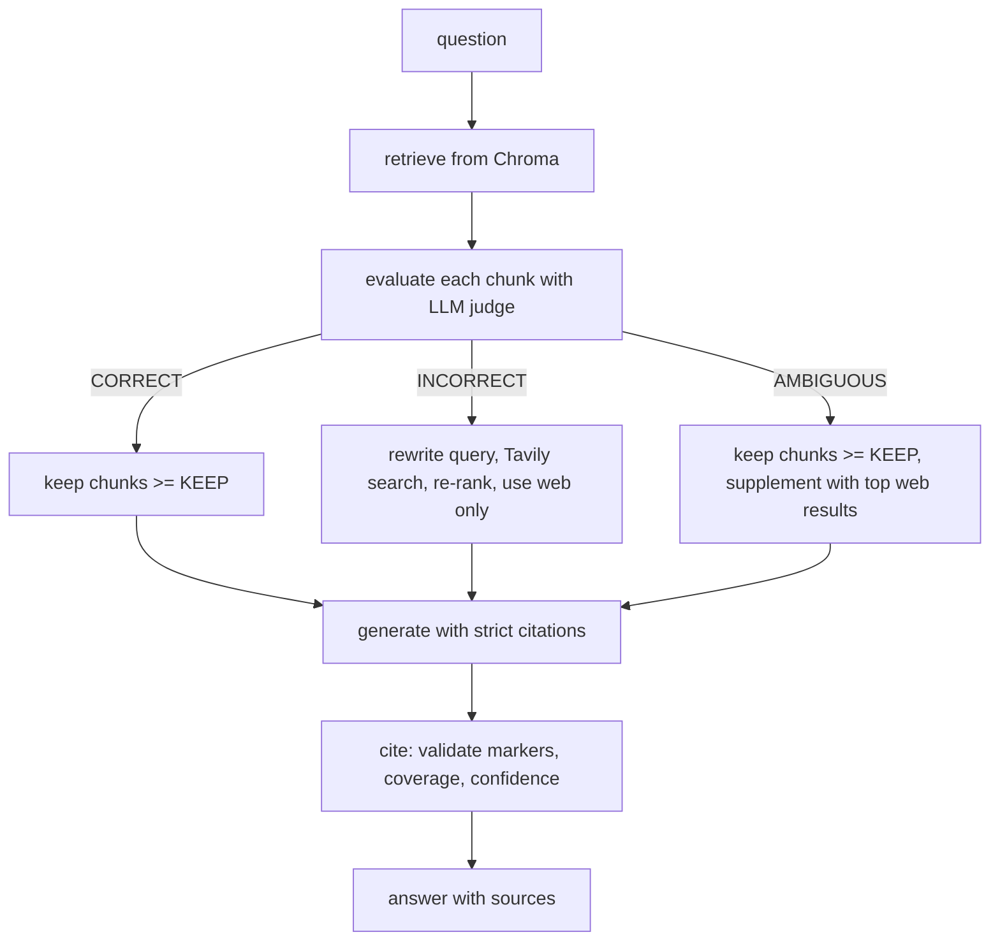

# LexGate

Legal document QA with Corrective RAG over GDPR and three EDPB guidelines. The app judges retrieved evidence before answering: strong corpus evidence is used directly, weak evidence triggers a re-ranked web search, and no usable evidence produces an abstention.

## Results (15-question frozen test set)

| # | Category | Naive | CRAG | CRAG branch |
|---|---|---|---|---|
| T01 | Covered | ✗ | ✗ | ✓ |
| T02 | Covered | ✓ | ✓ | ✓ |
| T03 | Covered | ✓ | ✗ | ✓ |
| T04 | Covered | ✓ | ✓ | ✓ |
| T05 | Covered | ✓ | ✓ | ✓ |
| T06 | Not covered | ✗ | ✓ | ✓ |
| T07 | Not covered | ✗ | ✗ | ✓ |
| T08 | Not covered | ✗ | ✓ | ✓ |
| T09 | Not covered | ✗ | ✓ | ✓ |
| T10 | Not covered | ✗ | ✗ | ✓ |
| T11 | Ambiguous | ✗ | ✓ | ✓ |
| T12 | Ambiguous | ✗ | ✓ | ✓ |
| T13 | Ambiguous | ✗ | ✓ | ✓ |
| T14 | Ambiguous | ✗ | ✓ | ✗ |
| T15 | Ambiguous | ✓ | ✗ | ✓ |

| Category | Naive correct | CRAG correct |
|---|---:|---:|
| Covered | 4/5 | 3/5 |
| Not covered | 0/5 | 3/5 |
| Ambiguous | 1/5 | 4/5 |

- CRAG branch accuracy: 93% (14/15); answer accuracy: naive 33%, CRAG 67%.
- Citation validity: 100% in both modes. Unsupported-claim counts: naive 1, CRAG 3.
- p50 latency: naive 9,379 ms; CRAG 15,427 ms. These exceed the TRD targets and are reported as-is.
- Full run: [`backend/eval/results/results.md`](backend/eval/results/results.md); machine-readable output: [`results.json`](backend/eval/results/results.json).
- LangSmith trace links are unavailable for this run because the configured API key was rejected (`401 Invalid token`). No run was pushed to LangSmith, so no link is fabricated.

## How CRAG decides



Decision rule: `max >= UPPER (0.7)` → CORRECT; `max < LOWER (0.3)` → INCORRECT; otherwise AMBIGUOUS. `KEEP (0.5)` filters context but is not part of the decision. Calibrated values are in [`backend/eval/results/calibration_thresholds.json`](backend/eval/results/calibration_thresholds.json).

## Architecture

- `backend/app/ingest/`: official-source fetch, GDPR/EDPB parsing, structure-aware chunking and index builds.
- `backend/app/retrieval/`: bge-small embedder, Chroma (`hnsw:space=cosine` via collection config), FAISS baseline and cross-encoder reranker.
- `backend/app/graph/`: CRAG state, decision functions, nodes and compiled `StateGraph`.
- `backend/app/api/` + `backend/app/main.py`: FastAPI `/query`, `/compare`, `/health`, `/corpus/stats`, `/eval/results`.
- `backend/eval/`: frozen test set, grader, eval runner, report and calibration artifacts.

Both stores are built from the same `chunks.jsonl` with the same embedder; naive RAG uses FAISS top-5 and the same generator prompt. Running `make ingest` twice produces the same chunk IDs.

## Setup

Requires Python 3.11 and `uv`.

```bash
cp .env.example .env
# Fill in GROQ_API_KEY and TAVILY_API_KEY. LANGSMITH_API_KEY is optional but needed for traces.
uv sync --directory backend
make ingest
make lint test
make eval
make api
```

`make api` runs `uvicorn app.main:app` from `backend`. `POST /query` accepts `{question, mode: "crag"|"naive", debug?}`. Set `DEMO_API_KEY` to require `X-API-Key`.

## Failure cases reviewed

1. **T14 branch misfire:** expected AMBIGUOUS, fired CORRECT. The judge scored the EDPB consent passages above 0.9 despite the ePrivacy half of the question. Change: tighten the two-instrument rule and add an ePrivacy-negative few-shot example.
2. **T10 hallucination:** CRAG named a “Chief of Data Processing” instead of *encarregado* from a law-firm source. Change: raise the trust floor for non-official sources or gate web answers by domain allowlist.
3. **T03 unsupported claim:** CRAG cited GDPR Art. 37(4) for a claim not supported by the retrieved chunk. Change: make the generator use only cited sentences and penalize extra claims earlier.

## Limitations

- The LLM judge is a stand-in for CRAG's fine-tuned evaluator; calibration is empirical, not guaranteed.
- 15 questions are a portfolio demonstration, not a benchmark.
- Web results are labelled and trust-weighted, not verified.
- Confidence is a heuristic, not a probability.
- Primary-source verification succeeded for 6 of 9 out-of-corpus reference points; T06, T08 and T12 use generic verified-scope statements because official pages were unreachable during Phase 5.
- Not legal advice. Demo over GDPR + 3 EDPB guidelines. Web results may be inaccurate.
