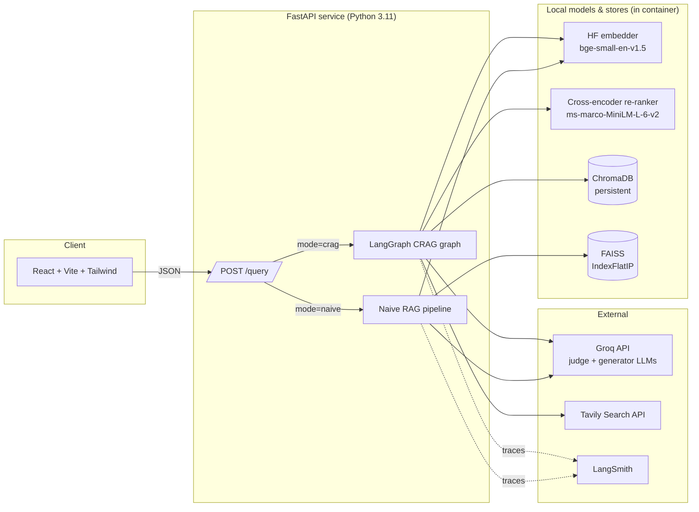
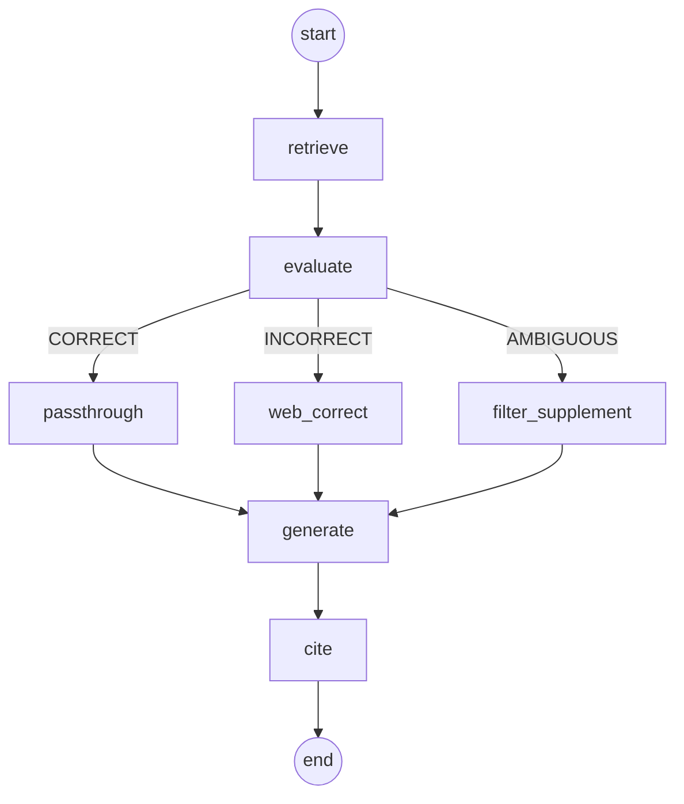

# 02 — Technical Requirements Document (TRD)

**Project:** LexGate (`legal-crag`)
**Depends on:** 01-PRD
**Status:** Draft v1.0, 2026-11-24

---

## 1. Architecture overview



**Key point:** Chroma and FAISS are built from the **same** `chunks.jsonl` using the **same** embedder. The only differences between naive and CRAG are the relevance gate and web correction. Both modes share the same data and generator, so the comparison isolates the gate.

## 2. Technology stack

| Layer | Choice | Version guidance | Notes |
|---|---|---|---|
| Language | Python | 3.11 | |
| Orchestration | LangGraph | pinned to `>=1.2,<2` | `StateGraph`, conditional edges |
| Chains | LangChain Core (LCEL) | pinned | Prompt templates, `with_structured_output`, `.abatch` |
| LLM provider | Groq via `langchain-groq` | pinned | Two roles: **judge** and **generator** |
| Judge model | `openai/gpt-oss-20b` (default) | env `GROQ_JUDGE_MODEL` | Reasoning model; `reasoning_effort="low"` (lowest GPT-OSS effort), temperature 0; called once per chunk |
| Generator model | `openai/gpt-oss-120b` (default) | env `GROQ_GEN_MODEL` | Reasoning model; also used for the query rewrite and the eval grader; temperature 0 |
| Embeddings | `BAAI/bge-small-en-v1.5` via `langchain-huggingface` / `sentence-transformers` | env `EMBED_MODEL` | 384-dim, normalized, cosine; query instruction prefix |
| Vector store (CRAG) | ChromaDB (`langchain-chroma`) | pinned | `PersistentClient`, collection `gdpr_v1`, cosine via `configuration={"hnsw": {"space": "cosine"}}` |
| Vector store (baseline) | FAISS (`faiss-cpu`) | pinned | `IndexFlatIP` on normalized vectors (exact search; corpus is small) |
| Re-ranker | `cross-encoder/ms-marco-MiniLM-L-6-v2` | env `RERANK_MODEL` | CPU-friendly; optional upgrade to `BAAI/bge-reranker-base` |
| Web search | Tavily (`tavily-python`) | pinned | `search_depth="advanced"`, `max_results=6` |
| Tracing | LangSmith | pinned | Env-based auto-tracing + root-run metadata |
| API | FastAPI + Uvicorn + Pydantic v2 | pinned | |
| Rate limiting | `slowapi` | | Demo only |
| Parsing | `beautifulsoup4` (EUR-Lex HTML), `pymupdf` (EDPB PDFs) | | |
| Frontend | React 18 + Vite + TypeScript + Tailwind | | TanStack Query for data fetching |
| Packaging | `uv` (or pip-tools) lockfile, Docker, Docker Compose | | |
| Tests | `pytest`, `pytest-asyncio`, `respx` (HTTP mocks) | | |

> **Groq model IDs change.** Check the current production list at console.groq.com/docs/models before starting. Model IDs are read only from config, and `/health` verifies them at startup.
>
> **Reasoning models.** `ChatGroq` exposes `reasoning_effort` (GPT-OSS accepts `low|medium|high`; `none`/`default` are Qwen-only). Use `reasoning_effort="low"` on the judge. Do **not** pass `reasoning_format` to GPT-OSS; to suppress reasoning content use `model_kwargs={"include_reasoning": False}`. Keep temperature 0.

## 3. Repository structure

```
legal-crag/
├── backend/
│   ├── app/
│   │   ├── main.py                 # FastAPI app factory, CORS, rate limit
│   │   ├── api/
│   │   │   ├── routes_query.py     # POST /query
│   │   │   ├── routes_meta.py      # /health, /corpus/stats, /eval/results
│   │   │   └── deps.py             # auth (demo key), singletons
│   │   ├── core/
│   │   │   ├── config.py           # pydantic-settings Settings
│   │   │   ├── logging.py
│   │   │   └── tracing.py          # LangSmith helpers
│   │   ├── schemas/                # Pydantic request/response models
│   │   ├── ingest/
│   │   │   ├── fetch.py            # download sources → data/raw
│   │   │   ├── parse_gdpr.py       # EUR-Lex HTML → articles/recitals
│   │   │   ├── parse_edpb.py       # PDF → sections
│   │   │   ├── chunk.py            # structure-aware chunking
│   │   │   ├── build_chroma.py
│   │   │   ├── build_faiss.py
│   │   │   └── manifest.py         # source hashes, chunk counts
│   │   ├── retrieval/
│   │   │   ├── embedder.py
│   │   │   ├── chroma_store.py
│   │   │   ├── faiss_store.py
│   │   │   └── reranker.py
│   │   ├── llm/
│   │   │   ├── groq_client.py      # judge + generator factories, retries
│   │   │   └── prompts.py          # ALL prompts, versioned constants
│   │   ├── pipelines/
│   │   │   └── naive_rag.py
│   │   └── graph/
│   │       ├── state.py            # CRAGState TypedDict
│   │       ├── builder.py          # StateGraph assembly + compile
│   │       ├── decision.py         # pure function: scores → decision
│   │       ├── confidence.py       # pure function: state → confidence
│   │       └── nodes/
│   │           ├── retrieve.py
│   │           ├── evaluate.py
│   │           ├── passthrough.py
│   │           ├── web_correct.py
│   │           ├── filter_supplement.py
│   │           ├── generate.py
│   │           └── cite.py
│   ├── eval/
│   │   ├── datasets/
│   │   │   ├── dev_set.jsonl       # 10 Qs for threshold tuning
│   │   │   └── test_set.jsonl      # 15 Qs, frozen
│   │   ├── run_eval.py
│   │   ├── grade.py                # LLM grader + manual override file
│   │   ├── report.py               # results.json → results.md table
│   │   └── results/                # timestamped outputs
│   ├── tests/
│   ├── data/                       # gitignored except manifest
│   │   ├── raw/  processed/  chroma/  faiss/
│   ├── pyproject.toml
│   └── Dockerfile
├── frontend/
│   ├── src/ (pages, components, api, types)
│   ├── Dockerfile
│   └── package.json
├── scripts/
│   ├── smoke.py
│   └── try_naive.py
├── docker-compose.yml
├── Makefile                        # ingest, eval, test, up, lint
├── .env.example
├── CHANGELOG.md
└── README.md
```

## 4. Ingestion pipeline

### 4.1 Sources
| `source_id` | Fetch | Parser |
|---|---|---|
| `gdpr` | EUR-Lex HTML for CELEX 32016R0679 (EN) | `parse_gdpr.py`: split on `Article N` headings and recital numbers; capture chapter/section titles |
| `edpb_consent_05_2020` | EDPB PDF | `parse_edpb.py`: PyMuPDF text + font-size heuristics for headings; strip headers/footers/page numbers |
| `edpb_breach_09_2022` | EDPB PDF | same |
| `edpb_access_01_2022` | EDPB PDF | same |

Raw files are saved under `data/raw/` with their SHA-256 recorded in `data/manifest.json`. Ingestion is **idempotent**: same inputs give the same chunk IDs.

### 4.2 Chunking strategy (structure-aware)
- **GDPR articles:** one chunk per **numbered paragraph** (e.g., Art. 17(1)). Short articles with no numbered paragraphs become a single chunk. Points (a)–(f) stay with their parent paragraph. If a paragraph exceeds 450 tokens, split it on point boundaries.
- **GDPR recitals:** one chunk per recital.
- **EDPB guidelines:** recursive split on headings, then paragraphs; target 400 tokens, 60-token overlap; keep the section path.
- **Contextual header:** every chunk's `embed_text` is prefixed with its breadcrumb, e.g.
  `GDPR > Chapter IV > Section 2 > Article 33 — Notification of a personal data breach to the supervisory authority > (1)`.
  `display_text` keeps the raw paragraph only (for UI and citations).
- **Chunk ID:** `{source_id}:{locator}`, e.g. `gdpr:art33:p1`, `gdpr:rec85`, `edpb_breach_09_2022:s2.1:c03`.

Expected size: about 1,200–1,800 chunks in total. This is small enough for exact FAISS search and fast Chroma builds.

### 4.3 Embedding
- `bge-small-en-v1.5`, `normalize_embeddings=True`.
- Queries are prefixed with `"Represent this sentence for searching relevant passages: "`; documents get no prefix.
- Batch size 64, done once at build time. The embedder is loaded once per process (singleton).

### 4.4 Index build
- `build_chroma.py` → `data/chroma/` collection `gdpr_v1` with metadata (see 05-backend-schema §3).
- `build_faiss.py` → `data/faiss/index.faiss` + `data/faiss/docstore.json` (row id → chunk id + metadata).
- `make ingest` runs fetch → parse → chunk → both builds → manifest, then prints stats.

## 5. Naive RAG baseline

```
question → embed → FAISS top-k (k=5) → generate (same GENERATE prompt) → cite → response
```
- `retrieval_decision = null` and `mode = "naive"` in the response.
- It uses the **same generator prompt, including the abstain instruction**, so any CRAG gain comes from the gate and web correction, not from prompt differences. Naive RAG may abstain too; record those cases in the results.

## 6. CRAG graph specification

### 6.1 Graph



> **Naming note.** In CRAG terms, the *Correct* action (corrective web search) fires on the **INCORRECT** decision. To avoid confusion the nodes are named `passthrough` (CORRECT), `web_correct` (INCORRECT) and `filter_supplement` (AMBIGUOUS).

### 6.2 Nodes

| Node | Input (state keys) | Output (state keys) | Details |
|---|---|---|---|
| `retrieve` | `question` | `retrieved` | Chroma similarity search, `k = RETRIEVE_K` (default 6). Stores the vector similarity too. |
| `evaluate` | `question`, `retrieved` | `chunk_scores`, `retrieval_decision`, `decision_reason` | Judges each chunk independently with an LLM (`.abatch`, `max_concurrency = JUDGE_CONCURRENCY`, default 6), then calls `decide()`. |
| `passthrough` | `retrieved`, `chunk_scores` | `context_sources` | Keeps chunks with score ≥ `KEEP_THRESHOLD`; type `corpus`. |
| `web_correct` | `question` | `web_query`, `web_results`, `context_sources` | Rewrites the query → Tavily → cross-encoder re-rank → top `WEB_TOP_N` (default 3). Corpus chunks are **discarded**. |
| `filter_supplement` | `question`, `retrieved`, `chunk_scores` | `web_query`, `web_results`, `context_sources` | Keeps chunks ≥ `KEEP_THRESHOLD`, adds the top `WEB_SUPPLEMENT_N` (default 2) re-ranked web results. |
| `generate` | `question`, `context_sources` | `draft_answer`, `abstained` | Generator LLM with the strict citation prompt; structured output. |
| `cite` | `draft_answer`, `context_sources` | `answer`, `sources`, `citation_report`, `confidence` | Validates `[S#]` markers, removes unused sources, computes coverage and confidence. |

### 6.3 Relevance evaluator (LLM-as-judge)

- **Per chunk, not per query.** Each call sees one `(question, chunk)` pair. This avoids position bias and lets one irrelevant chunk be dropped without affecting the others.
- **Structured output** (Groq JSON mode / `with_structured_output`):
  ```json
  {"score": 0.0-1.0, "verdict": "relevant|partial|irrelevant", "reason": "<= 30 words", "jurisdiction_match": true}
  ```
- **Anchored rubric** in the prompt:
  - `0.9–1.0` — directly answers the question, or contains the governing rule.
  - `0.6–0.8` — on the same legal topic and useful, but doesn't fully answer.
  - `0.3–0.5` — tangentially related (same law, different obligation).
  - `0.0–0.2` — unrelated, **or about a different jurisdiction/instrument than the question asks about**.
- The jurisdiction rule is the legal-domain change from the CRAG paper. A GDPR chunk scores ≤ 0.2 for a CCPA question even when the topic (fines) matches.
- 3 few-shot examples (one per band) live in `prompts.py` as `EVALUATOR_PROMPT_V1`. Prompts are versioned and the version is logged to LangSmith metadata.
- Temperature 0. On a JSON parse failure: retry once, then mark that chunk `score=null, error=true` and leave it out of the decision.

### 6.4 Decision rule (`graph/decision.py`, pure function)

Following the CRAG paper's upper/lower threshold scheme:

```
valid = [s for s in scores if s is not None]
if not valid:                      -> AMBIGUOUS   (conservative: supplement with web)
elif max(valid) >= UPPER (0.7):    -> CORRECT
elif max(valid) <  LOWER (0.3):    -> INCORRECT
else:                              -> AMBIGUOUS
```
- `decide(scores, upper, lower) -> Decision` is a pure function containing only the `UPPER`/`LOWER` logic above. **KEEP is not part of the decision.**
- `select_kept(scores, keep) -> list[ChunkScore]` is a second pure function that filters chunks below `KEEP_THRESHOLD` (default 0.5). It is called only by the `passthrough` and `filter_supplement` nodes, and is unit-tested independently (including the zero-kept case from 03 §4.2). Both functions live in `graph/decision.py`.
- Thresholds that the decision uses (`UPPER`, `LOWER`) and the context filter uses (`KEEP`) come from env, are **tuned on `dev_set.jsonl` only**, and are recorded with every eval run.
- `decision_reason` is a human-readable string, e.g. `"max=0.42 (gdpr:art83:p5); 0 chunks ≥ 0.7; 2 chunks ≥ 0.3"`.

### 6.5 Web correction

1. **Query rewrite** (generator LLM, temperature 0): turns the question into a keyword search query and keeps the jurisdiction named in the question. It does **not** inject "GDPR" unless the question is about the GDPR.
2. **Tavily**: `search_depth="advanced"`, `max_results=6`, `include_raw_content=False`. Optional `include_domains` from `WEB_DOMAIN_ALLOWLIST` (off by default; trust weighting is used instead).
3. **Re-rank**: cross-encoder score on `(question, title + content)`, then
   `final = 0.8 * sigmoid(ce_score) + 0.2 * domain_trust(url)`
   where `domain_trust` is 1.0 for official sources (`eur-lex.europa.eu`, `edpb.europa.eu`, `*.gov`, `oag.ca.gov`, `ico.org.uk`, `curia.europa.eu`, `hhs.gov`), 0.6 for reputable secondary sources (`gdpr-info.eu`, `iapp.org`, law-firm domains in a list), and 0.3 otherwise.
4. Keep the top N, with the full Tavily snippet as `display_text`.

**Failure handling:** if Tavily errors or times out (8 s), INCORRECT → generate with an empty context → forced abstain; AMBIGUOUS → continue with the filtered chunks only and set `warnings += ["web_search_failed"]`.

### 6.6 Generation and citation enforcement

- The context is rendered as numbered blocks:
  ```
  [S1] (corpus) GDPR Art. 33(1) — Notification of a personal data breach…
  <text>
  [S2] (web) oag.ca.gov — "CCPA Enforcement…" (retrieved 2026-11-24)
  <text>
  ```
- Key system-prompt rules (`GENERATE_PROMPT_V1`):
  1. Use **only** the numbered sources. No outside knowledge, including the model's own knowledge of the law.
  2. Every sentence that states a fact ends with one or more `[S#]` markers.
  3. If corpus and web sources disagree, say so and cite both.
  4. If the sources don't answer the question, reply with the abstain response and explain what's missing.
  5. Don't present web content as the text of the regulation. Label it ("According to [S2]…").
  6. Plain-English answer, ≤ 200 words, no legal advice.
- **Structured output:** `{"answer": str, "used_source_ids": ["S1",...], "abstained": bool}`.
- **Cite node checks:**
  - Parse markers with a regex `\[S(\d+)\]`. Any marker not in the context → `invalid_citations`.
  - `citation_coverage` = sentences with ≥ 1 valid marker ÷ factual sentences (sentences that aren't headings, disclaimers or abstain text).
  - If `invalid_citations` exist or coverage < 0.8: **one regeneration** with a corrective instruction. If it still fails, return the answer with `warnings += ["low_citation_coverage"]` and a confidence penalty.
  - `sources` in the response contains **only cited sources**, renumbered in the order they first appear.

### 6.7 Confidence (heuristic — documented as not a calibrated probability)

```
evidence      = mean(score of each cited source)   # corpus: judge score; web: rerank final
coverage      = citation_coverage
source_factor = 1.0 (CORRECT) | 0.85 (AMBIGUOUS) | 0.7 (INCORRECT/web-only)
confidence    = round(evidence * coverage * source_factor, 2)
label         = High ≥ 0.7 | Medium ≥ 0.45 | Low otherwise
abstained     → confidence = 0.0, label = "None"
```
For naive mode, `evidence` = mean cosine similarity of the cited chunks (and the README states that this isn't comparable to CRAG confidence).

## 7. API

**05-backend-schema is the source of truth for all schemas.** This section is a summary only; where it disagrees with 05, 05 wins.

| Method | Path | Purpose |
|---|---|---|
| `POST` | `/query` | Body `{question, mode: "crag"\|"naive", debug?}` → answer payload |
| `POST` | `/compare` | Runs both modes concurrently and returns `{naive, crag}` (for the UI side-by-side) |
| `GET` | `/health` | Liveness + model/index readiness |
| `GET` | `/corpus/stats` | Chunk counts per source, manifest version |
| `GET` | `/eval/results` | Latest eval run (serves `results.json`) |
| `GET` | `/query/stream` *(P2)* | SSE node-progress events |

## 8. Observability (LangSmith)

- Env: `LANGSMITH_TRACING=true`, `LANGSMITH_API_KEY`, `LANGSMITH_PROJECT=legal-crag`.
- Each request runs inside a `@traceable(name="crag_query")` root with a generated `run_id` (UUID) that is returned to the client as `trace_id`.
- The graph is invoked with `config={"run_name": "crag_graph", "tags": [f"mode:{mode}"], "metadata": {...}}`.
- After the graph returns, the root run is updated (via `get_current_run_tree()`) with:
  - `metadata.retrieval_decision`, `metadata.max_chunk_score`, `metadata.kept_chunks`, `metadata.web_results_used`, `metadata.confidence`, `metadata.prompt_versions`, `metadata.thresholds`
  - tag `decision:CORRECT|AMBIGUOUS|INCORRECT`
- The `evaluate` node's own span returns `chunk_scores` and the decision as outputs, so the decision is visible inside the graph trace as well.
- Eval runs use the LangSmith **dataset + experiment** API (`client.evaluate` or `aevaluate`) so each eval is a named experiment (`crag-v1-thr0.7-0.3`), with feedback keys `branch_correct`, `answer_correct` and `citation_valid`.
- The UI's "View trace" link: `https://smith.langchain.com/...` built from the run ID. Shared/public trace links are created for the README examples.

## 9. Non-functional requirements

| Category | Requirement |
|---|---|
| Latency | Naive p50 ≤ 2.5 s. CRAG CORRECT p50 ≤ 4 s; AMBIGUOUS/INCORRECT p50 ≤ 6 s and p95 ≤ 10 s. Timeouts: Groq 20 s, Tavily 8 s, overall request 30 s. |
| Throughput | Demo: ~5 concurrent users. Uvicorn with 1–2 workers (models load per worker, so watch RAM). |
| Memory | Embedder (~130 MB) + cross-encoder (~90 MB) + Chroma + FAISS → container ≤ 2 GB RAM. |
| Resilience | Retry 429/5xx from Groq with exponential backoff and jitter (max 3). Graceful degradation as in §6.5. |
| Determinism | Temperature 0 everywhere; prompt versions and thresholds logged per request. |
| Security | Secrets only via env/`.env`. The demo API requires an `X-API-Key` header (public read-only key for the UI) and a per-IP limit of 10 req/min with `slowapi`. CORS allowlist. Input max 500 chars. Stack traces never returned. |
| Prompt injection | Web content goes inside delimited source blocks; the system prompt says to treat source text as data. The question is length-limited. |
| Privacy | No user data is stored apart from optional anonymised query logs (SQLite, off by default). |
| Accessibility (UI) | WCAG 2.1 AA (see 04). |

## 10. Configuration (`.env.example`)

```bash
# LLMs
GROQ_API_KEY=
GROQ_JUDGE_MODEL=openai/gpt-oss-20b
GROQ_GEN_MODEL=openai/gpt-oss-120b
GROQ_JUDGE_REASONING_EFFORT=low   # lowest GPT-OSS effort; temperature stays 0
# Retrieval
EMBED_MODEL=BAAI/bge-small-en-v1.5
RERANK_MODEL=cross-encoder/ms-marco-MiniLM-L-6-v2
CHROMA_DIR=./data/chroma
CHROMA_COLLECTION=gdpr_v1
FAISS_DIR=./data/faiss
RETRIEVE_K=6
NAIVE_K=5
# CRAG thresholds
UPPER_THRESHOLD=0.7
LOWER_THRESHOLD=0.3
KEEP_THRESHOLD=0.5
JUDGE_CONCURRENCY=6
# Web
TAVILY_API_KEY=
WEB_TOP_N=3
WEB_SUPPLEMENT_N=2
WEB_DOMAIN_ALLOWLIST=            # comma-separated, empty = trust weighting only
# Observability
LANGSMITH_TRACING=true
LANGSMITH_API_KEY=
LANGSMITH_PROJECT=legal-crag
# API
DEMO_API_KEY=
CORS_ORIGINS=http://localhost:5173
RATE_LIMIT=10/minute
```

## 11. Testing strategy

| Level | What | Tooling |
|---|---|---|
| Unit | `decide()` boundaries (0.3/0.7 edges, all-null), `select_kept()` (including zero-kept), confidence formula, citation parser/coverage, chunker on fixture HTML, domain trust | pytest |
| Retrieval config | Chroma cosine distance is actually configured: create a collection via `configuration={"hnsw": {"space": "cosine"}}`, add an identical vector pair and an orthogonal pair, assert distance ≈ 0 and ≈ 1 respectively; assert the stored collection configuration reports `space == "cosine"`. Do not trust a metadata key alone. | pytest (marked `slow`) |
| Node | Each node with a fake LLM (`FakeListChatModel` / stubbed structured output) and a stubbed Tavily | pytest-asyncio, respx |
| Graph | Three forced-branch tests: stub judge scores → assert the path taken and the state shape | pytest |
| Contract | `/query` response validates against the Pydantic schema; OpenAPI snapshot | FastAPI TestClient |
| Retrieval sanity | 10 hand-written query → expected-chunk pairs; recall@5 ≥ 0.8 for both stores | pytest (marked `slow`) |
| Evaluation | 15-question test set, both modes | `make eval` (not in CI by default — costs credits) |

CI (GitHub Actions): lint (ruff), type-check (mypy, light), unit + node + graph + contract tests. No external API calls in CI.

## 12. Deployment

- **Local:** `docker compose up` runs `api` (port 8000) and `web` (port 5173 / nginx 80). Indexes are built by `make ingest` and mounted at `./backend/data`.
- **Public demo (proposed):**
  - Backend → **Hugging Face Spaces (Docker SDK)**: indexes and models are baked into the image at build time (`RUN python -m app.ingest.build_all`), so the corpus is static and cold starts are fast.
  - Frontend → **Netlify** (static Vite build), `VITE_API_URL` pointing to the Space.
  - Secrets set in Space settings. Example questions cached (in-memory LRU keyed by question + mode + prompt version) to save credits.
- Images: `python:3.11-slim`, CPU-only torch wheel, non-root user, model weights downloaded during build into `HF_HOME`.

## 13. Known limitations (state them in the README)

- The LLM-as-judge is a stand-in for CRAG's fine-tuned evaluator; its calibration is checked empirically, not guaranteed.
- 15 questions is a demonstration, not a benchmark. Document this in the README.
- Web results can be wrong or out of date; they are labelled and weighted by trust, not verified.
- Confidence is a heuristic score, not a probability.
