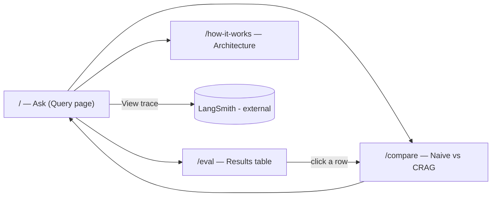
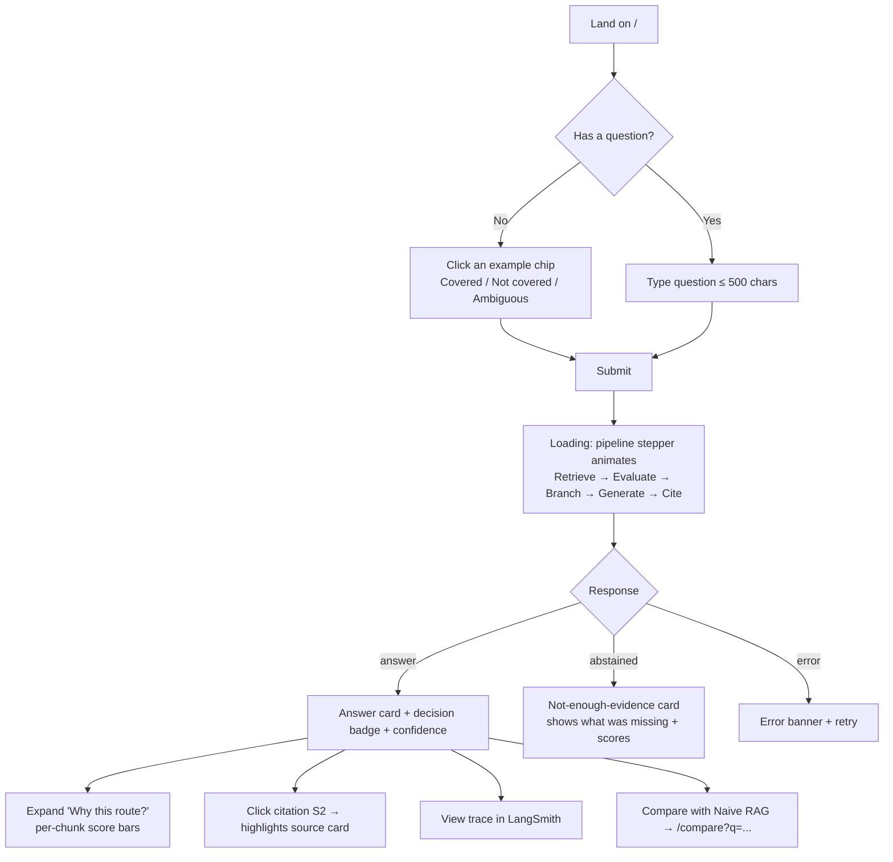
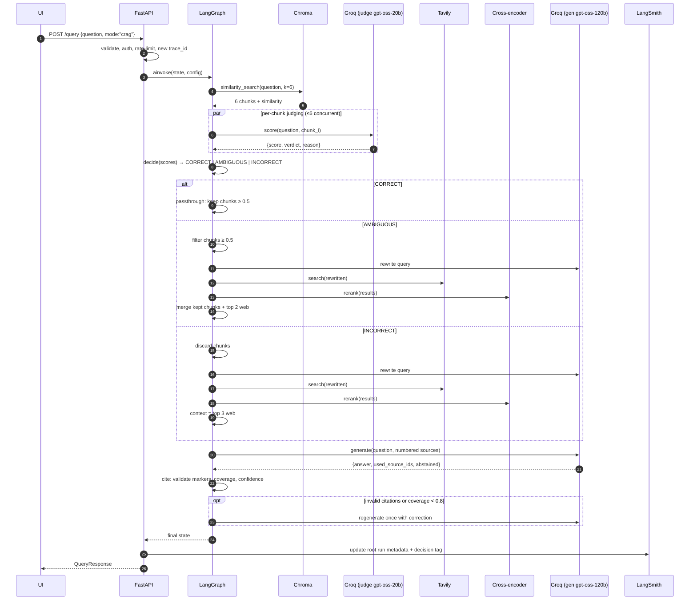
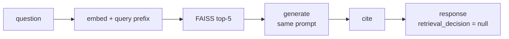

# 03 — App Flow

**Project:** LexGate (`legal-crag`)
**Depends on:** 01-PRD, 02-TRD
**Status:** Draft v1.0, 2026-11-24

User routes and request flows, including branches, failure paths and data handoffs.

---

## 1. Site map (frontend)



| Route | Purpose | Primary action |
|---|---|---|
| `/` | Ask one question in CRAG mode (mode toggle available) | Submit question |
| `/compare` | Same question through Naive RAG and CRAG side by side | Submit question |
| `/eval` | Table of the 15 test questions × 2 modes, filterable by category | Open a row in compare view |
| `/how-it-works` | Graph diagram, threshold explanation, corpus list, limitations | Read |

Query params make results shareable: `/?q=...&mode=crag`, `/compare?q=...`.

## 2. Primary user flows

### 2.1 Ask a question (CRAG)



### 2.2 Compare mode
1. The user enters a question or arrives with `?q=` from the Ask page or the Eval table.
2. The frontend calls `POST /compare` (one request, both pipelines run concurrently on the server).
3. Two columns render: **Naive RAG** (left) and **CRAG** (right). Each shows its answer, sources, confidence and trace link. CRAG also shows the decision badge and chunk scores.
4. A **Diff hint** strip above the columns summarises the difference, e.g. *"Naive answered from GDPR Art. 83; CRAG rejected all 6 chunks (max 0.18) and used web sources."* It is generated client-side from the two payloads with no extra LLM call.

### 2.3 Browse eval results
1. `/eval` loads `GET /eval/results`.
2. Summary cards: branch accuracy, answer accuracy per mode, and per category.
3. Table rows: question, category, expected branch, actual branch, naive ✓/✗, CRAG ✓/✗, links to both traces.
4. Clicking a row opens `/compare?q=<question>` (a live re-run, labelled as such, because the results may differ from the recorded run).

## 3. System flow — `POST /query` (mode = crag)



## 4. Branch-level flows

### 4.1 CORRECT → passthrough
```
retrieved (6) ── judge ──► scores e.g. [0.95, 0.80, 0.55, 0.30, 0.10, 0.05]
max ≥ 0.7 → CORRECT
keep ≥ 0.5 → 3 chunks → S1..S3 (all type=corpus)
generate → cite → confidence ≈ evidence(0.77) × coverage(1.0) × 1.0
```
Edge case: if every chunk ≥ 0.7 is dropped later (impossible by construction, since KEEP < UPPER), there is still at least one chunk.

### 4.2 AMBIGUOUS → filter_supplement
```
scores e.g. [0.62, 0.55, 0.40, 0.20, 0.10, 0.05]   (max in [0.3, 0.7))
keep ≥ 0.5 → 2 corpus chunks
web: rewrite → Tavily (6) → rerank → top 2
context = S1,S2 (corpus) + S3,S4 (web)
generate: must attribute each claim; if corpus and web disagree, say so
```
Edge case: the filter keeps 0 chunks (all scores in [0.3, 0.5)). Context = web only and the decision **stays AMBIGUOUS**, with `warnings: ["no_corpus_chunks_above_keep"]`, so the UI still reports AMBIGUOUS.

### 4.3 INCORRECT → web_correct
```
scores e.g. [0.18, 0.12, 0.10, 0.05, 0.05, 0.02]   (max < 0.3)
discard all corpus chunks
web: rewrite (keeps jurisdiction, e.g. "CCPA civil penalties amount per violation") → Tavily → rerank → top 3
context = S1..S3 (web)
UI shows "Outside curated corpus" banner
```

### 4.4 Abstain (any branch)
The generator returns `abstained: true` when the context doesn't support an answer. Response: `answer` = a short explanation of what is missing, `sources` = the sources considered (all with `used: false`), `confidence = 0`, label `None`. The "Not enough evidence" card lists what was checked and what was missing (see 04).

## 5. System flow — `POST /query` (mode = naive)



## 6. Error and degradation flows

| Failure | Where | Behaviour | User sees |
|---|---|---|---|
| Empty or > 500-char question | API validation | 422 | Inline field error |
| Missing or invalid API key (demo) | API | 401 | "Demo key missing — reload page" |
| Rate limit exceeded | API | 429 + `Retry-After` | Toast with countdown |
| Groq 429/5xx | judge/gen calls | Retry ×3 with backoff, then fail the node | If the judge fails for every chunk → decision AMBIGUOUS (conservative) with warning `judge_unavailable`; if the generator fails → 503 |
| Judge JSON parse error on one chunk | evaluate | Retry once, then `score=null` (left out of the decision) | Chunk shows "not scored" in the score table |
| Tavily error/timeout | web_correct | Context empty → forced abstain | Abstain card + "Web search unavailable" warning |
| Tavily error/timeout | filter_supplement | Continue with corpus chunks only | Warning chip `web_search_failed` |
| Citation validation fails twice | cite | Return with warning and a confidence penalty (×0.5) | Amber "Some statements may lack citations" chip |
| Chroma/FAISS not built | startup | `/health` returns `ready:false`; `/query` returns 503 | "Index not ready" page |
| Request exceeds 30 s | API | 504 | Error banner + retry |

All warnings travel in `warnings: string[]` in the response and in the LangSmith metadata.

## 7. Developer flows

### 7.1 Ingest
```
make ingest
 ├─ fetch.py         → data/raw/{gdpr.html, edpb_*.pdf}  (+ sha256)
 ├─ parse_gdpr.py    → data/processed/gdpr_units.jsonl
 ├─ parse_edpb.py    → data/processed/edpb_units.jsonl
 ├─ chunk.py         → data/processed/chunks.jsonl        (single source of truth)
 ├─ build_chroma.py  → data/chroma/
 ├─ build_faiss.py   → data/faiss/index.faiss + docstore.json
 └─ manifest.py      → data/manifest.json (hashes, counts, embed model, built_at)
```

### 7.2 Threshold calibration (Phase 2)
```
make judge-dev        # runs retrieve + evaluate only on dev_set (10 Qs), dumps all chunk scores
python eval/plot_scores.py   # histogram of scores by human label → pick UPPER/LOWER
edit .env thresholds → re-run → record in eval/results/calibration.md
```

### 7.3 Evaluation (Phase 5)
```
make eval
 ├─ load test_set.jsonl (15 Qs, frozen)
 ├─ for each Q × {naive, crag}: POST internal pipeline, store response + trace_id
 ├─ grade.py: LLM grader (gpt-oss-120b) vs reference points → correct/partial/incorrect/abstained
 │            + manual_overrides.yaml applied last (human has the final say)
 ├─ push to LangSmith experiment
 └─ report.py → results.json + results.md (table pasted into README)
```

## 8. State lifecycle (CRAG)

| After node | Keys populated |
|---|---|
| input | `question`, `mode`, `request_id` |
| `retrieve` | `retrieved` |
| `evaluate` | `chunk_scores`, `retrieval_decision`, `decision_reason` |
| branch node | `context_sources`, (`web_query`, `web_results` on web branches), `warnings` |
| `generate` | `draft_answer`, `used_source_ids`, `abstained`, `generation_attempts` |
| `cite` | `answer`, `sources`, `citation_report`, `confidence`, `confidence_label` |

The full state schema is in **05-backend-schema §2**.
