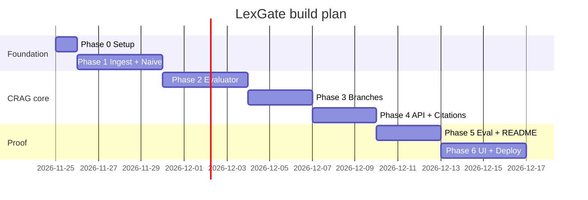

# 06 — Implementation Plan

**Project:** LexGate (`legal-crag`)
**Depends on:** 01–05
**Status:** Draft v1.0, 2026-11-24
**Estimated effort:** ~17–21 focused working days (part-time: 4–6 weeks)

---

## 0. Ground rules

- **Build the baseline before CRAG.** You need naive RAG numbers to compare against.
- **Keep the dev and test sets separate.** Tune thresholds and prompts on `dev_set.jsonl` only. Freeze `test_set.jsonl` and run it for the final results (and whenever a prompt or threshold version changes, recording the new version).
- **Pure functions for logic.** `decide()`, `compute_confidence()`, `parse_citations()` and `domain_trust()` have no I/O and are fully unit-tested.
- **Every LLM call is traced and versioned** from day one, not added at the end.
- **Commit at the end of each phase**, tagged `phase-N`, with a short entry in `CHANGELOG.md`. Those entries become the "how I built it" section of the README.

---

## Phase 0 — Project setup (0.5–1 day)

| # | Task | Output |
|---|---|---|
| 0.1 | Create the repo `legal-crag` with the structure from TRD §3 | Folder skeleton |
| 0.2 | `pyproject.toml` with `uv`: `langgraph>=1.2,<2`, langchain-core, langchain-groq, langchain-chroma, langchain-huggingface, sentence-transformers, faiss-cpu, chromadb, tavily-python, fastapi, uvicorn, pydantic-settings, slowapi, langsmith, beautifulsoup4, pymupdf; dev: pytest, pytest-asyncio, respx, ruff, mypy | Lockfile |
| 0.3 | `Settings` (05 §10), `.env.example`, `Makefile` targets: `ingest`, `test`, `eval`, `judge-dev`, `api`, `up`, `lint` | Config |
| 0.4 | Get API keys: Groq, Tavily, LangSmith. Check current Groq production model IDs and set them in `.env` | `.env` |
| 0.5 | Smoke script: one Groq call, one Tavily call, one traced LangSmith run | `scripts/smoke.py` passes |
| 0.6 | GitHub Actions: ruff + pytest (no network) | Green CI badge |

**Done when:** `make lint test` passes and the smoke trace appears in the LangSmith project `legal-crag`.

---

## Phase 1 — Ingestion + baseline RAG (3–4 days)

| # | Task | Notes |
|---|---|---|
| 1.1 | `fetch.py`: download the GDPR EN HTML from EUR-Lex and the three EDPB PDFs into `data/raw/`; record sha256 | If downloads are flaky, commit the raw files (they're public) |
| 1.2 | `parse_gdpr.py`: extract chapters, sections, articles (number + title), numbered paragraphs with their points, and recitals | Fixture test: Art. 6 has paragraphs 1–4 and para 1 has points (a)–(f); there are 99 articles and 173 recitals |
| 1.3 | `parse_edpb.py`: PyMuPDF text blocks; heading detection by font size/bold; remove running headers, footers and page numbers; keep section numbers | Spot-check 3 sections per PDF by eye |
| 1.4 | `chunk.py`: the structure-aware rules from TRD §4.2; build `breadcrumb`, `citation_label`, `url` (with article anchors), `embed_text`; write `chunks.jsonl` | Validate every line against the `Chunk` model |
| 1.5 | `embedder.py` singleton (bge-small, normalized, query prefix) | |
| 1.6 | `build_chroma.py` + `build_faiss.py` from the same `chunks.jsonl`; `manifest.py` | Consistency check (05 §2.2). Add the Chroma 1.x cosine-distance test (identical vectors ≈ 0, orthogonal ≈ 1, collection config reports `space == "cosine"`); do not trust a metadata key |
| 1.7 | `naive_rag.py`: FAISS top-5 → `GENERATE_PROMPT_V1` → simple citation parse | The generator prompt is written here and reused in Phase 4 |
| 1.8 | Retrieval sanity test: 10 query → expected-chunk pairs; recall@5 for Chroma and FAISS | Target ≥ 0.8. If lower, fix chunking before moving on |
| 1.9 | Notebook/script `scripts/try_naive.py`: run 5 example questions and inspect them manually | Note the first silent failures you see (these become README material) |

**Done when:** `make ingest` builds both stores reproducibly (same chunk count and IDs on re-run), recall@5 ≥ 0.8, and naive RAG answers T01 correctly with a citation to `GDPR Art. 33(1)`.

**Watch out for:** EUR-Lex HTML structure (articles are marked with specific classes or IDs, so inspect the HTML before writing selectors); footnotes and corrigenda; PDF hyphenation across line breaks.

---

## Phase 2 — The CRAG evaluator node (3–4 days) ⭐ core

| # | Task | Notes |
|---|---|---|
| 2.1 | Write the 10-question **dev set** (4 covered / 3 not covered / 3 ambiguous) and the 15-question **test set** draft (05 §7.2). Freeze the test set wording now; verify the `[verify]` reference points in Phase 5 | Don't look at test-set judge scores while tuning |
| 2.2 | Write `EVALUATOR_PROMPT_V1`: role, anchored 4-band rubric, **jurisdiction/instrument rule**, 3 few-shot examples, JSON output spec | See TRD §6.3 |
| 2.3 | `JudgeOutput` structured output on `openai/gpt-oss-20b` with `reasoning_effort="low"`, temperature 0; retry on parse failure; `.abatch` with `max_concurrency` | Handle Groq 429s with backoff |
| 2.4 | `graph/decision.py`: `decide(scores, upper, lower)` + unit tests (all null, boundaries at exactly 0.3 and 0.7, a single chunk), and separate `select_kept(scores, keep)` + unit tests (including zero-kept) | Both pure; KEEP is not part of the decision |
| 2.5 | Hand-label relevance for every (dev question, retrieved chunk) pair: about 60 labels (`relevant` / `partial` / `irrelevant`) | 1–2 hours of work; this is your ground truth for calibrating the judge |
| 2.6 | `make judge-dev`: run retrieve + evaluate on the dev set and dump the scores alongside your labels | CSV |
| 2.7 | Calibration analysis (`eval/plot_scores.py`): score distribution per human label, plus agreement between judge verdicts and your labels | Write `eval/results/calibration.md` with a histogram + chosen thresholds + reasoning |
| 2.8 | Iterate on the prompt (V2, V3…) **only on dev data** until (a) branch accuracy on dev is ≥ 8/10 and (b) "irrelevant" chunks score < 0.3 at least 90% of the time | Keep each version, since the change log makes a good README section |
| 2.9 | Optional experiment: judge model `openai/gpt-oss-20b` vs `openai/gpt-oss-120b` for accuracy and latency. Record the result | Interesting trade-off for interviews |

**Done when:** `calibration.md` documents the thresholds with evidence, the dev branch accuracy target is met, and the evaluator alone runs in < 1.5 s for 6 chunks.

**Pitfalls:**
- Scores bunching around 0.5–0.7 → anchor the bands harder and add a "partial" few-shot example.
- The judge rewards topic overlap (fines ↔ fines) over jurisdiction → strengthen the jurisdiction rule and add a CCPA-vs-GDPR negative example.
- Batched judging (all chunks in one call) is tempting for speed. Don't: per-chunk judging is a stated requirement and avoids position bias.

---

## Phase 3 — Branches: passthrough, web_correct, filter_supplement (2–3 days)

| # | Task | Notes |
|---|---|---|
| 3.1 | `graph/state.py` (05 §4) with reducers for `warnings` and `timings_ms` | |
| 3.2 | `retrieve` and `evaluate` nodes wrapping Phase 1–2 code | |
| 3.3 | `passthrough`: keep ≥ KEEP, build `ContextSource` S1..Sn (corpus) | |
| 3.4 | `REWRITE_PROMPT_V1` + rewrite chain (keeps the jurisdiction; no automatic "GDPR") | Test: a CCPA question doesn't gain "GDPR" in the rewrite |
| 3.5 | `reranker.py`: cross-encoder singleton; `domain_trust()` with tiered domain lists; `final_score` | Unit-test `domain_trust` |
| 3.6 | `web_correct`: rewrite → Tavily (8 s timeout) → rerank → top 3; discard the corpus chunks | Failure → empty context + warning |
| 3.7 | `filter_supplement`: filter ≥ KEEP + top 2 web; handle the zero-kept edge case | 03 §4.2 |
| 3.8 | `builder.py`: `StateGraph(CRAGState)`, `add_conditional_edges("evaluate", route_after_evaluate, {...})`, compile once at startup | |
| 3.9 | Graph tests: stub the judge to force each branch and assert the node path and `context_sources` kinds; stub Tavily with respx | 3 tests, no network |
| 3.10 | Temporary generate node (reuse the naive generator) so the graph runs end to end | Replaced in Phase 4 |
| 3.11 | Run the dev set end to end and check that each branch fires at least once in LangSmith | Screenshot the graph view |

**Done when:** all three branches fire on the appropriate dev questions, the graph tests pass, and source lists keep corpus and web items clearly separated.

---

## Phase 4 — Generation, citation enforcement, API, tracing (3 days)

| # | Task | Notes |
|---|---|---|
| 4.1 | Final `GENERATE_PROMPT_V1` (TRD §6.6): numbered and typed source blocks, strict rules, abstain format, `GenerateOutput` | Same prompt in naive mode |
| 4.2 | `cite` node: marker regex, invalid/unused detection, factual-sentence splitter, coverage, renumbering, one corrective regeneration | Unit-test the parser on tricky cases: `[S1][S2]`, `[S1, S2]`, a marker before the period |
| 4.3 | `confidence.py` (TRD §6.7) + tests | |
| 4.4 | FastAPI app: `/query`, `/compare` (run both modes with `asyncio.gather`), `/health`, `/corpus/stats`, `/eval/results`; error envelope; request IDs; 30 s timeout | Pydantic models from 05 §6 |
| 4.5 | Singletons loaded in the lifespan handler (embedder, reranker, stores, compiled graph); health checks verify the Groq model IDs | |
| 4.6 | LangSmith: `@traceable` root with run ID → `trace_id`; graph config with run name, tags and metadata; post-run metadata update + `decision:*` tag; build `trace_url` | Confirm `retrieval_decision` can be filtered in the LangSmith UI |
| 4.7 | Security for the demo: `X-API-Key`, slowapi rate limit, CORS allowlist, input length limit, no stack traces in responses | |
| 4.8 | Contract tests with TestClient + an OpenAPI snapshot | |
| 4.9 | Docker: backend Dockerfile (python:3.11-slim, CPU torch, models pre-downloaded, non-root) + compose with a volume for `data/` | `docker compose up api` works |

**Done when:** `curl -X POST /query` returns the full `QueryResponse` for every branch, citation validity is 100% on the dev set, and each trace shows `retrieval_decision` in its metadata and as a tag.

---

## Phase 5 — Evaluation harness + README (2–3 days)

| # | Task | Notes |
|---|---|---|
| 5.1 | Verify every `[verify]` reference point in the test set against a primary source (official regulator pages, CJEU, EUR-Lex). Record the source URL in `notes`. Then **freeze** `test_set.jsonl` (commit hash in the run config) | Never use model memory as ground truth |
| 5.2 | `run_eval.py`: for each item × mode, call the pipeline in-process, collect an `EvalRecord`, and push to a LangSmith dataset/experiment with `eval_qid` metadata | |
| 5.3 | `GRADER_PROMPT_V1` (`openai/gpt-oss-120b`): compare the answer to `reference_points`; count unsupported claims against the *sources in context* | |
| 5.4 | Manual review of all 30 answers → `manual_overrides.yaml` | Human decision wins; this is what makes the table credible |
| 5.5 | `report.py`: `results.json` → `results.md` (per-question table + per-category summary + latency) | Matches 05 §7.4 |
| 5.6 | Generate public LangSmith share links for 3 example traces (one per branch) | |
| 5.7 | README: problem → CRAG in one diagram → **results table** → 3 annotated traces → architecture → how to run → limitations → what I'd do next | The results table goes near the top |
| 5.8 | Write up 2–3 failure cases honestly (e.g. a branch misfire), with the trace and what you'd change | Interviewers value this a lot |

**Done when:** `make eval` reproduces `results.md`, and the README shows the comparison with links to traces.

**Expected shape of results (hypothesis, not a promise):** covered: naive ≈ CRAG; not covered: naive mostly ✗ (answers with GDPR content) or abstains, CRAG mostly ✓ through web; ambiguous: CRAG ahead because it merges sources. If naive abstains well thanks to the shared prompt, say so: the gate's value then shows up as *answering correctly with the right sources* instead of abstaining.

---

## Phase 6 — Frontend, deployment, demo assets (3–4 days)

| # | Task | Notes |
|---|---|---|
| 6.1 | Vite + React + TS + Tailwind + Router + TanStack Query; design tokens as CSS variables (04 §3) | |
| 6.2 | `types/api.ts` mirroring the backend response models (or generated from OpenAPI with `openapi-typescript`) | Prefer generation |
| 6.3 | Ask page: input, mode toggle, example chips, stepper, result panel components | 04 §5.1 |
| 6.4 | `WhyThisRoute` score table with threshold lines; abstain card; warnings; outside-corpus banner | The key demo components |
| 6.5 | Compare page + `diffHint.ts`; mobile tabs | |
| 6.6 | Results page: summary cards, category chart, sortable table | |
| 6.7 | How-it-works page | |
| 6.8 | Accessibility pass (keyboard, aria-live, contrast check) + dark mode | 04 §8 |
| 6.9 | Frontend Dockerfile (nginx) + compose for both services | `docker compose up` gives the full app |
| 6.10 | Deploy: backend to HF Spaces (Docker; indexes and models baked in at build), frontend to Netlify; set secrets; response cache for example questions | Smoke-test every branch on the live URL |
| 6.11 | Record the hero GIF (compare on the CCPA question) + 3 screenshots; add them to the README | 04 §11 |

**Done when:** the public URL works end to end, and a fresh clone with `.env` filled in works with `docker compose up` in under 10 minutes.

---

## Stretch goals (after v1)

| Item | Value |
|---|---|
| SSE streaming of node progress (`/query/stream`) | A real stepper instead of a simulated one |
| Knowledge-strip refinement on CORRECT (decompose-then-recompose, as in the CRAG paper) | Fidelity to the paper; less noise in the context |
| Run the evaluator on web results | Gates both sources |
| A third baseline: "naive + always web" | Separates the gate's effect from the effect of web access, which makes the analysis much stronger |
| Larger eval (50 questions) using RAGAS-style faithfulness metrics | More credible numbers |
| Metadata filtering by `effective_date` / `instrument` | Handles time-period questions |

---

## Timeline (part-time, ~2–3 h/day + weekends)

## Risk register (implementation level)

| Risk | Phase | Mitigation |
|---|---|---|
| EUR-Lex HTML is hard to parse | 1 | Fallback: the GDPR text from the official PDF, or a cleaner HTML mirror, verified against EUR-Lex for article boundaries |
| Groq free-tier rate limits during eval (15 × 2 × ~8 calls) | 2, 5 | `JUDGE_CONCURRENCY=3` during eval, backoff, cache judge results per (question, chunk_id, prompt_version) on disk |
| Judge can't separate jurisdictions | 2 | Add an explicit `jurisdiction_match` field; a rule in `decide()` that caps the score at 0.2 when `jurisdiction_match=false` (documented as a heuristic) |
| Tavily returns blogs instead of official sources | 3 | Trust weighting; optional allowlist mode for the eval run, recorded in the config |
| Not enough RAM in HF Spaces for two local models | 6 | Both models are small (~220 MB together); fallback: Render with 2 GB, or drop the reranker to Tavily scores + trust (documented) |
| Scope creep on the UI | 6 | Ship the Ask + Compare pages first; Results and How-it-works can be simple |

## Definition of done (v1.0)

- [ ] `make ingest`, `make test`, `make eval` all work from a clean clone
- [ ] The three branches demonstrably fire; `retrieval_decision` is in the API response, the UI and LangSmith
- [ ] Citation validity is 100% on the test set; unsupported claims are reported honestly
- [ ] The README shows the Naive vs CRAG table by category, 3 trace links, the hero GIF and limitations
- [ ] The public demo is live with a rate limit and the "Not legal advice" disclaimer
- [ ] Thresholds and prompts are documented with calibration evidence from the dev set
